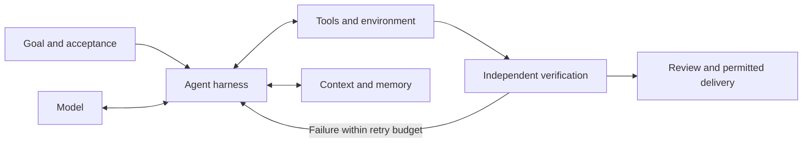

# Awesome AI Agents · 2026

### Find an AI agent for the work you want done.

Get help with code, research or everyday tasks. Choose an agent by what it can do and how you want to use it.

**[Find your agent →](#find-your-agent)**

## Find your agent

Choose a task below. Each link leads to the official project or product, where you can check availability and setup.

| What you want to do | Agents to explore |
|---|---|
| Write, fix or review code | [Codex](https://github.com/openai/codex), [Claude Code](https://github.com/anthropics/claude-code), [OpenCode](https://github.com/anomalyco/opencode) |
| Research a question | [OpenAI Deep Research](https://openai.com/index/introducing-deep-research/), [Gemini Deep Research](https://gemini.google.com/) |
| Handle a repeat workflow | [Goose](https://github.com/aaif-goose/goose), [Hermes Agent](https://github.com/NousResearch/hermes-agent), [OpenClaw](https://github.com/openclaw/openclaw) |
| Turn an idea into an app | [Replit Agent](https://replit.com/ai), [Lovable](https://lovable.dev/), [v0](https://v0.dev/) |

For a first run, try one code change or a report on one question. If you are automating a workflow or building an app, start with one repeat task or one screen. Check the result before expanding the job.

Hosted agents may require an account or plan; local agents need installation and a model connection. Review tool access before connecting private files or services.

**[Browse coding agents](#coding-agents) · [Research and everyday agents](#research-and-everyday-agents) · [Compare harnesses](docs/HARNESS-RESEARCH.md)**

## Contents

1. [Coding agents](#coding-agents)
2. [Research and everyday agents](#research-and-everyday-agents)
3. [Agent runtimes and platforms](#agent-runtimes-and-platforms)
4. [How agents run: the harness](#the-harness-matters)
5. [Agent frameworks](#agent-frameworks)
6. [Protocols and standards](#protocols-and-standards)
7. [Agent skills and repo context](#agent-skills-and-repo-context)
8. [Multi-agent patterns](#multi-agent-patterns)
9. [Agent memory](#agent-memory)
10. [Observability and evaluation](#observability-and-evaluation)
11. [Security and guardrails](#security-and-guardrails)
12. [Voice agents](#voice-agents)
13. [Deployment and sandboxing](#deployment-and-sandboxing)
14. [Knowledge and retrieval](#knowledge-and-retrieval)
15. [October highlights](#october-highlights)
16. [Freshness and evidence](#freshness-and-evidence)
17. [Related awesome lists](#related-awesome-lists)
18. [Contributing](#contributing)

For builders: [Framework guide](FRAMEWORKS.md) · [Local model tools](LOCAL-LLM-TOOLS.md) · [Model setup](MODEL-RUNNING-GUIDE.md). For the visual direction: [Artwork prompt](docs/assets/PREMIUM-PROMPT.md).

## Coding agents

Give a coding agent a concrete change to make. Compare the interface and model setup you prefer, then verify its changes in your repository.

| Agent | Interface | What it helps you do |
|---|---|---|
| [OpenCode](https://github.com/anomalyco/opencode) | Terminal | Work on a repository with your chosen model provider |
| [Claude Code](https://github.com/anthropics/claude-code) | Terminal | Implement changes and use repository-specific workflows |
| [Gemini CLI](https://github.com/google-gemini/gemini-cli) | Terminal | Work on code through a Gemini terminal workflow |
| [Codex](https://github.com/openai/codex) | Terminal | Make and verify code changes through a terminal agent |
| [OpenHands](https://github.com/OpenHands/OpenHands) | Web / CLI | Delegate development work in an execution environment |
| [Cline](https://github.com/cline/cline) | VS Code / CLI / SDK | Edit and test code through an editor or CLI |
| [Open Interpreter](https://github.com/openinterpreter/openinterpreter) | Terminal / CLI | Use code execution to work on files and tasks |
| [Aider](https://github.com/Aider-AI/aider) | Terminal | Pair on code changes tracked in Git |
| [Orca](https://github.com/stablyai/orca) | Desktop / mobile / VPS | Coordinate several coding-agent workspaces |
| [Qwen Code](https://github.com/QwenLM/qwen-code) | Terminal | Work on repository tasks from the terminal |
| [pi](https://github.com/earendil-works/pi) | TUI / CLI toolkit | Code with a small, extensible terminal agent |
| [Chorus](https://github.com/chorus-codes/chorus) | CLI harness | Review proposed changes through multiple models |

### Coding-agent ecosystem

[Claude Code Router](https://github.com/musistudio/claude-code-router) · [Claude Code Templates](https://github.com/davila7/claude-code-templates) · [AgenticFlowX](https://github.com/AgenticFlowX/agenticflowx) · [SWE-agent](https://github.com/SWE-agent/SWE-agent) · [GitHub Copilot](https://github.com/features/copilot) · [Cursor](https://cursor.com/) · [Windsurf](https://windsurf.com/)

## Research and everyday agents

| Agent | What it helps you do | How you use it |
|---|---|---|
| [OpenAI Deep Research](https://openai.com/index/introducing-deep-research/) | Investigate a question and produce a report with sources | Hosted research workflow |
| [Gemini Deep Research](https://gemini.google.com/) | Research a topic in the Gemini ecosystem | Hosted research workflow |
| [Goose](https://github.com/aaif-goose/goose) | Work on code or repeat tasks with connected tools | Desktop app or CLI on your machine |
| [Hermes Agent](https://github.com/NousResearch/hermes-agent) | Keep context across personal workflows and reusable skills | Local agent with tool and channel connections |
| [OpenClaw](https://github.com/openclaw/openclaw) | Run a personal assistant across connected channels and tools | Self-hosted assistant |

Choose the tool access your task needs. Check the actual result before relying on it or letting a workflow continue unattended.

## Agent runtimes and platforms

| Runtime | Delivery | Use case |
|---|---|---|
| [OpenClaw](https://github.com/openclaw/openclaw) | Self-hosted | Personal assistants across channels with tools and memory |
| [Goose](https://github.com/aaif-goose/goose) | Local / self-hosted | Extensible agent with MCP and any-LLM support |
| [OpenHands](https://github.com/OpenHands/OpenHands) | Open source | Software-development agents and sandboxed execution |
| [NVIDIA OpenShell](https://github.com/NVIDIA/OpenShell) | Self-hosted | Policy-governed private sandboxes for autonomous agents |
| [Docker Agent](https://github.com/docker/docker-agent) | Docker Desktop / self-hosted | Declarative YAML agents with MCP tools |
| [Kun](https://github.com/KunAgent/Kun) | Local-first | Desktop/TUI workspace for agent tasks |
| [Mission Control](https://github.com/builderz-labs/mission-control) | Self-hosted | Dispatch and operations across agent runtimes |
| [Autonomous OS](https://github.com/autonomous-ai/Physical-AI-Operating-System) | Edge / self-hosted | Physical-AI operating system with swappable agent runtimes and deterministic safety bounds |
| [AgenticROS](https://github.com/agenticros/agenticros) | ROS 2 / self-hosted | Robot tools with MCP adapters |
| [OpenAI Deep Research](https://openai.com/index/introducing-deep-research/) | Hosted | Long-running, citation-oriented research |
| [Gemini Deep Research](https://gemini.google.com/) | Hosted | Research tasks in the Google ecosystem |
| [Manus](https://manus.im/) | Hosted | General-purpose autonomous task execution |
| [Replit Agent](https://replit.com/ai) | Hosted | Build and deploy applications from natural language |
| [v0](https://v0.dev/) | Hosted | UI and application generation |
| [Lovable](https://lovable.dev/) | Hosted | Product-oriented application prototyping |

### Lightweight and always-on runtimes

Repository metadata checked **13 October 2026**. Language and design goals describe upstream projects; hardware footprint and reliability require workload measurements.

| Runtime | Language / shape | Best fit |
|---|---|---|
| [Hermes Agent](https://github.com/NousResearch/hermes-agent) | Python / local agent | Persistent personal workflows with skills |
| [nanobot](https://github.com/HKUDS/nanobot) | Python / lightweight | Small agent for chat and tool use |
| [ZeroClaw](https://github.com/zeroclaw-labs/zeroclaw) | Rust / single binary | Rust assistant runtime with policy controls |
| [NanoClaw](https://github.com/nanocoai/nanoclaw) | TypeScript / containers | OpenClaw-like channels with container isolation and memory |
| [PicoClaw](https://github.com/sipeed/picoclaw) | Go / tiny runtime | Small hardware and deploy-anywhere assistant scenarios |
| [IronClaw](https://github.com/nearai/ironclaw) | Rust / Agent OS | Rust assistant runtime with a security focus |
| [NullClaw](https://github.com/nullclaw/nullclaw) | Zig / minimal runtime | Small autonomous assistant infrastructure |

### New runtime, control-plane, and physical-agent candidates

Additional execution surfaces for fleet operations, shared workspaces and physical systems. Repository status is recorded in the [October snapshot](docs/data/catalog-2026-10-13.json).

| Project | Shape | Best fit |
|---|---|---|
| [herdr](https://github.com/herdrdev/herdr) | Rust / terminal runtime | Workspaces and lifecycle management for coding-agent fleets |
| [holaOS](https://github.com/holaboss-ai/holaOS) | TypeScript / agent workspace | Shared context and MCP across applications |
| [Archestra](https://github.com/archestra-ai/archestra) | TypeScript / gateway | Controlled enterprise access to MCP and A2A |
| [Open Multi-Agent](https://github.com/open-multi-agent/open-multi-agent) | TypeScript / orchestrator | Dynamic multi-agent workflows in a Node.js application |
| [Wippy](https://github.com/wippyai/runtime) | Go / Lua-WASM runtime | Durable actor runtime with policy controls |
| [AgenticFlowX](https://github.com/AgenticFlowX/agenticflowx) | VS Code / workflow layer | VS Code agent workflows with repository traceability |

## The harness matters

The harness controls tools, context, permissions, recovery and verification around a model. Choose and evaluate that combination on your own workload.

The October research adds [OpenBench](https://github.com/minghinmatthewlam/openbench), [Harbor](https://github.com/harbor-framework/harbor) and [Finding the Right Fit](https://arxiv.org/abs/2610.00917). These sources examine different configurations and task sets. They support controlled comparisons, with results kept attached to their tested settings.

**[Read the harness comparison →](docs/HARNESS-RESEARCH.md)** It covers Codex, Claude Code, OpenCode, pi, Gemini CLI, OpenHands, Hermes and Deep Agents, plus an evaluation checklist and the limits of published pilots.

## Agent frameworks

| Framework | Best fit |
|---|---|
| [LangGraph](https://github.com/langchain-ai/langgraph) | Stateful execution with recovery and human intervention |
| [Deep Agents](https://github.com/langchain-ai/deepagents) | Planning harness with files and subagents |
| [Microsoft Agent Framework](https://github.com/microsoft/agent-framework) | Python/.NET agents and multi-agent workflows |
| [CrewAI](https://github.com/crewAIInc/crewAI) | Role-based agents and coordinated workflows |
| [OpenAI Agents SDK](https://github.com/openai/openai-agents-python) | Tool-using agents with handoffs and tracing |
| [Claude Agent SDK for Python](https://github.com/anthropics/claude-agent-sdk-python) | Building around Claude Code primitives and tool use |
| [Google ADK](https://github.com/google/adk-python) | Code-first agents in the Google ecosystem |
| [Pydantic AI](https://github.com/pydantic/pydantic-ai) | Type-safe agents and validated structured output |
| [Mastra](https://github.com/mastra-ai/mastra) | TypeScript agents and workflows |
| [Vercel AI SDK](https://github.com/vercel/ai) | Provider-agnostic TypeScript toolkit for applications and tool-loop agents |
| [CopilotKit](https://github.com/CopilotKit/CopilotKit) | Agent interfaces with shared state and approval flows |
| [Stately Agent](https://github.com/statelyai/agent) | State-machine-controlled LLM agents |
| [Workflow SDK](https://github.com/vercel/workflow) | Durable TypeScript workflows |
| [smolagents](https://github.com/huggingface/smolagents) | Small code-first agents and `CodeAgent` workflows |
| [Agno](https://github.com/agno-agi/agno) | Model-agnostic agents with tool access |
| [mcp-agent](https://github.com/lastmile-ai/mcp-agent) | MCP-native agents and compact workflow patterns |
| [Vercel Eve](https://github.com/vercel/eve) | Filesystem-oriented agent framework |
| [Omnigent](https://github.com/omnigent-ai/omnigent) | Meta-harness for interoperable coding agents and policy controls |
| [Open Multi-Agent](https://github.com/open-multi-agent/open-multi-agent) | TypeScript orchestration with runtime-planned task DAGs |
| [Archestra](https://github.com/archestra-ai/archestra) | MCP/A2A access gateway and orchestration |

## Protocols and standards

| Protocol | Purpose |
|---|---|
| [Model Context Protocol (MCP)](https://modelcontextprotocol.io/specification/latest) | Connect agents to tools, data, prompts, and resources |
| [MCP Servers](https://github.com/modelcontextprotocol/servers) | Official reference servers and implementation examples |
| [Agent2Agent (A2A)](https://a2a-protocol.org/latest/) | Discover, delegate, and exchange artifacts between opaque agents |
| [AG-UI](https://github.com/ag-ui-protocol/ag-ui) | Stream agent state, events, and human interaction into user-facing applications |
| [OpenAI function calling](https://platform.openai.com/docs/guides/function-calling) | Structured tool calls and schema-constrained actions |
| [Anthropic tool use](https://docs.anthropic.com/en/docs/build-with-claude/tool-use) | Model-directed tools and structured results |
| [Agent Client Protocol (ACP)](https://github.com/agentclientprotocol/agent-client-protocol) | Connect editors and agent runtimes through a common protocol |
| [AGENTS.md](https://github.com/agentsmd/agents.md) | Portable repository guidance for coding agents |

**Mental model:** MCP is the agent-to-tool boundary. A2A is the agent-to-agent boundary. They solve different problems and compose cleanly.

## Agent skills and repo context

The complete current catalog is in [SKILLS.md](SKILLS.md). The table below keeps the main index scannable while preserving the important domain boundaries.

| Project | Role |
|---|---|
| [OpenAI Skills](https://github.com/openai/skills) | Codex skill catalog; inspect each skill's instructions and permissions |
| [Superpowers](https://github.com/obra/superpowers) | Agentic skills framework and software-development methodology |
| [Understand-Anything](https://github.com/Egonex-AI/Understand-Anything) | Interactive codebase knowledge graph for Claude Code, Codex, Cursor, Copilot, and Gemini CLI |
| [AGENTS.md](https://github.com/agentsmd/agents.md) | Keep project-specific constraints, workflows, and safety context close to the repository |
| [NVIDIA Agent Skills](https://github.com/NVIDIA/skills) | Skills for NVIDIA platform and robotics workflows |
| [Trail of Bits Skills](https://github.com/trailofbits/skills) | Security research and verification for coding agents |
| [AWS Agent Toolkit](https://github.com/aws/agent-toolkit-for-aws) | AWS tools and skills for coding agents |
| [AWS MCP servers](https://github.com/awslabs/mcp) | AWS-focused MCP server collection; the upstream README points new work to Agent Toolkit for AWS |
| [.NET Agent Skills](https://github.com/dotnet/skills) | .NET/C# development and agent workflows |
| [David Ondrej Skills](https://github.com/davidondrej/skills) | General engineering and research skills |
| [Interfaces Skills](https://github.com/jakubkrehel/skills) | Interface design and accessibility skills |
| [Bankr Skills](https://github.com/BankrBot/skills) | On-chain workflows; transactions need approval |
| [Chris Banes Skills](https://github.com/chrisbanes/skills) | Kotlin and Android development skills |
| [dzhng Skills](https://github.com/dzhng/skills) | Planning and engineering workflows |
| [Pedro Nauck Skills](https://github.com/pedronauck/skills) | Engineering and business skill catalog |
| [Social Media Skills](https://github.com/social-media-skills/skills) | Social-media workflows; publishing needs approval |
| [Aident Loadout](https://github.com/Aident-AI/aident-skill) | Connect Codex, Claude Code, Cursor and other MCP clients to 1,000+ apps and 400+ Skills through one reusable setup |

Skills are executable context, not decoration: prefer scoped permissions, explicit stop conditions, and a testable outcome.

## Multi-agent patterns

| Pattern | Use when | Control that must exist |
|---|---|---|
| **Pipeline** | Steps are known and ordered | Explicit state between stages |
| **Orchestrator / worker** | Work can be split across specialists | Central planner, bounded workers |
| **Handoff** | A specialist should own the next turn | Typed transfer and stop conditions |
| **Debate / critique** | A second opinion reduces costly errors | Independent proposal and review |
| **Reflection** | Output can be checked and improved | Separate verifier and retry budget |
| **Human approval** | Actions are costly or irreversible | Approval gate before side effects |

Production rule: define a closed task, machine-checkable oracle, maximum step count, and explicit stop path before adding more agents.

## Agent memory

| Tool | Focus |
|---|---|
| [Mem0](https://github.com/mem0ai/mem0) | Cross-session memory with temporal retrieval |
| [Letta](https://github.com/letta-ai/letta) | Stateful agents and editable long-term memory |
| [Cognee](https://github.com/topoteretes/cognee) | Persistent knowledge-graph memory |
| [TencentDB-Agent-Memory](https://github.com/TencentCloud/TencentDB-Agent-Memory) | Agent-memory storage and retrieval patterns |
| [OpenViking](https://github.com/volcengine/OpenViking) | Filesystem-shaped context database |
| [Synapse](https://github.com/Supersynergy/synapse-memory) | Local cited memory with recovery checkpoints |

Memory is a product decision, not a vector-store checkbox: define retention, deletion, tenant boundaries, provenance, and recovery before shipping.

## Observability and evaluation

| Tool / benchmark | Focus |
|---|---|
| [Harbor](https://github.com/harbor-framework/harbor) | Evaluation environments and agent adapters |
| [OpenBench](https://github.com/minghinmatthewlam/openbench) | Controlled harness comparisons with external task checkers |
| [Langfuse](https://github.com/langfuse/langfuse) | Open-source observability and evaluation |
| [Arize Phoenix](https://github.com/Arize-ai/phoenix) | AI observability and evaluation |
| [OpenTelemetry](https://opentelemetry.io/) | Vendor-neutral traces, metrics, and logs |
| [Terminal-Bench](https://github.com/harbor-framework/terminal-bench) | real terminal tasks with tests and execution harness |
| [BrowserGym](https://github.com/ServiceNow/BrowserGym) | web-agent research across browser benchmarks |
| [SWE-bench](https://github.com/SWE-bench/SWE-bench) | reproducible software-engineering tasks |
| [Mission Control](https://github.com/builderz-labs/mission-control) | Agent dispatch and operations |

Track task success, tool success, latency, token cost, retries, human interventions, and unsafe-action attempts. A transcript alone is not an evaluation.

## Security and guardrails

[NVIDIA NeMo Guardrails](https://github.com/NVIDIA-NeMo/Guardrails) · [Guardrails AI](https://github.com/guardrails-ai/guardrails) · [Trail of Bits Skills](https://github.com/trailofbits/skills) · [Snyk Agent Scan](https://github.com/snyk/agent-scan) · [garak](https://github.com/NVIDIA/garak) · [Microsoft Presidio](https://github.com/data-privacy-stack/presidio)

Minimum controls: least-privilege tool scopes, server allowlists, validated tool output, sandboxing, egress limits, max steps, cost limits, audit logs, and human approval for irreversible actions.

## Voice agents

[LiveKit Agents](https://github.com/livekit/agents) · [OpenAI Realtime API](https://platform.openai.com/docs/guides/realtime) · [Vapi](https://vapi.ai/) · [Retell AI](https://www.retellai.com/) · [ElevenLabs Conversational AI](https://elevenlabs.io/conversational-ai)

## Deployment and sandboxing

| Tool | Use case |
|---|---|
| [NVIDIA OpenShell](https://github.com/NVIDIA/OpenShell) | Declarative filesystem, process, network, and inference policies for agent sandboxes |
| [OpenSandbox](https://github.com/opensandbox-group/OpenSandbox) | Secure, extensible sandbox runtime with coding-agent and Kubernetes examples |
| [Docker Agent](https://github.com/docker/docker-agent) | YAML-defined agents, multi-agent orchestration, and MCP tools in Docker |
| [Blaxel Sandbox](https://github.com/blaxel-ai/sandbox) | Isolated micro-VM templates and sandbox API for agent-generated workloads |
| [E2B](https://github.com/e2b-dev/E2B) | Secure environments for agent-generated code |
| [Ollama](https://github.com/ollama/ollama) | Local model serving and developer workflows |
| [llama.cpp](https://github.com/ggml-org/llama.cpp) | Portable local inference |
| [vLLM](https://github.com/vllm-project/vllm) | High-throughput model serving |
| [llm-d](https://github.com/llm-d/llm-d) | Kubernetes inference performance and routing for model- and agent-serving workloads |
| [Modal](https://modal.com/) | Serverless compute for agent and model workloads |
| [BentoML](https://github.com/bentoml/BentoML) | Packaging and serving model-backed applications |

Sandbox untrusted code. Treat model output as data until a policy layer validates the action.

## Knowledge and retrieval

| Tool | Focus |
|---|---|
| [Qdrant](https://github.com/qdrant/qdrant) | Filterable vector search and retrieval |
| [pgvector](https://github.com/pgvector/pgvector) | Vector search inside PostgreSQL |
| [Haystack](https://github.com/deepset-ai/haystack) | Modular search, RAG, and agent pipelines |
| [DSPy](https://github.com/stanfordnlp/dspy) | Programmatic prompt and LM optimisation |
| [LlamaIndex](https://github.com/run-llama/llama_index) | Data connectors, indexing, and retrieval workflows |
| [Understand-Anything](https://github.com/Egonex-AI/Understand-Anything) | Codebase graph and interactive repository understanding for agent workflows |
| [OpenViking](https://github.com/volcengine/OpenViking) | Context database that unifies agent memory, knowledge, and skills |
| [CodeGraph](https://github.com/colbymchenry/codegraph) | Local code knowledge graph for coding-agent retrieval and change context |

Choose storage by deletion semantics, tenant isolation, filter support, provenance, and operational cost—not by embedding demos alone.

## October highlights

| Addition or correction | Why it belongs here |
|---|---|
| [LangGraph](https://github.com/langchain-ai/langgraph) and [Deep Agents](https://github.com/langchain-ai/deepagents) | Distinguish durable stateful orchestration from a higher-level agent harness |
| [Microsoft Agent Framework](https://github.com/microsoft/agent-framework) | Current Python/.NET agent and workflow framework; upstream provides AutoGen and Semantic Kernel migration guides |
| [Harness research](docs/HARNESS-RESEARCH.md) | Compare actual model routes, tools, configuration and accepted outcomes |
| Repository status cleanup | Canonical links updated; archived Kimi CLI moved out of the current coding shortlist |
| [Friendly agent artwork](docs/assets/PREMIUM-PROMPT.md) | Original hero artwork with a reusable prompt and accessible alt text |

The [October audit](docs/UPDATE-2026-10-13.md) explains what was checked. July and August research remains in the audit trail.

## Freshness and evidence

- **Repository metadata:** [13 October snapshot](docs/data/catalog-2026-10-13.json), including canonical URLs, archive flags, default-branch revisions, license metadata and latest published release fields.
- **Capabilities:** upstream documentation and the linked [harness research](docs/HARNESS-RESEARCH.md). No shared performance benchmark was executed for this update.
- **Historical research:** [August audit](docs/UPDATE-2026-08-02.md), [July audit](docs/UPDATE-2026-07-14.md) and [frontier notes](docs/FRONTIER-BREAKTHROUGHS-2026-07-14.md).
- **Selection signals:** stars and recent pushes can help discovery. They do not establish reliability, security, licensing of every component or suitability for your workload.

Archived projects can remain valuable references. They are excluded from this current shortlist; see the [status changes](docs/UPDATE-2026-10-13.md#repository-status-changes) for this pass.

## Related awesome lists

| List | Focus |
|---|---|
| [e2b-dev/awesome-ai-agents](https://github.com/e2b-dev/awesome-ai-agents) | Broad open- and closed-source agent directory |
| [caramaschiHG/awesome-ai-agents-2026](https://github.com/caramaschiHG/awesome-ai-agents-2026) | Broad catalog and category recall |
| [Zijian-Ni/awesome-ai-agents-2026](https://github.com/Zijian-Ni/awesome-ai-agents-2026) | Multilingual catalog with changelog and archive flags |
| [ARUNAGIRINATHAN-K/awesome-ai-agents-2026](https://github.com/ARUNAGIRINATHAN-K/awesome-ai-agents-2026) | Broad stack with security, observability, and deployment lanes |
| [Deep-Insight-Labs/awesome-ai-agents](https://github.com/Deep-Insight-Labs/awesome-ai-agents) | Frameworks, observability, and emerging projects |
| [hesreallyhim/awesome-claude-code](https://github.com/hesreallyhim/awesome-claude-code) | Claude Code skills, plugins, agents, and tooling |
| [punkpeye/awesome-mcp-servers](https://github.com/punkpeye/awesome-mcp-servers) | MCP server discovery |
| [mcp-security-project/awesome-agentic-mcp-security](https://github.com/mcp-security-project/awesome-agentic-mcp-security) | MCP and agentic security research, tooling, labs, and advisories |
| [e2b-dev/awesome-ai-sdks](https://github.com/e2b-dev/awesome-ai-sdks) | SDKs and building blocks |
| [bradAGI/awesome-cli-coding-agents](https://github.com/bradAGI/awesome-cli-coding-agents) | Terminal-native coding agents, harnesses, parallel runners, and infrastructure |
| [sammcj/agentic-coding](https://github.com/sammcj/agentic-coding) | Agentic coding rules, templates, and workflow guidance |
| [mokevnin/agentic-coding-design-patterns](https://github.com/mokevnin/agentic-coding-design-patterns) | Current agentic software-development patterns |

Use broad lists for recall. Use this index's dated audit and upstream links for currentness.

## Contributing

Before adding an entry:

1. Link to the official upstream or product documentation.
2. State one concrete capability and one target user/use case.
3. Check that the project is active, documented, and not archived.
4. Avoid unsupported market share, benchmark, pricing, or adoption claims.
5. Add the date and source when a claim is time-sensitive.

PRs are welcome. See [CONTRIBUTING.md](CONTRIBUTING.md).

## License

MIT License — see [LICENSE](LICENSE).

**Checked 13 October 2026** · [Contributing guide](CONTRIBUTING.md) · [Audit](docs/UPDATE-2026-10-13.md)
