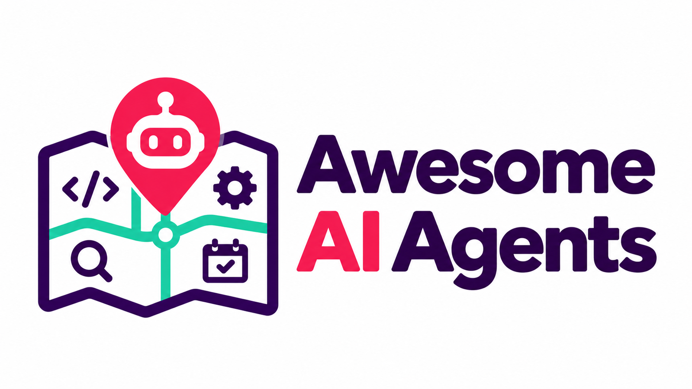
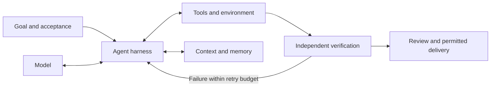

  

# Awesome AI Agents · 2026

### Find an AI agent for the work you want done.

Get help with code, research or everyday tasks. Choose an agent by what it can do and how you want to use it.

**[Find your agent →](#find-your-agent)**

## Find your agent

Choose a task below. Each link leads to the official project or product, where you can check availability and setup.

<strong>📋 Show 4 entries</strong>

- **Write, fix or review code** 
  Agents to explore: [Codex](https://github.com/openai/codex), [Claude Code](https://github.com/anthropics/claude-code), [OpenCode](https://github.com/anomalyco/opencode)

- **Research a question** 
  Agents to explore: [OpenAI Deep Research](https://openai.com/index/introducing-deep-research/), [Gemini Deep Research](https://gemini.google.com/)

- **Handle a repeat workflow** 
  Agents to explore: [Goose](https://github.com/aaif-goose/goose), [Hermes Agent](https://github.com/NousResearch/hermes-agent), [OpenClaw](https://github.com/openclaw/openclaw)

- **Turn an idea into an app** 
  Agents to explore: [Replit Agent](https://replit.com/ai), [Lovable](https://lovable.dev/), [v0](https://v0.dev/)

For a first run, try one code change or a report on one question. If you are automating a workflow or building an app, start with one repeat task or one screen. Check the result before expanding the job.

Hosted agents may require an account or plan; local agents need installation and a model connection. Review tool access before connecting private files or services.

**[Browse coding agents](#coding-agents) · [Research and everyday agents](#research-and-everyday-agents) · [Compare harnesses](docs/HARNESS-RESEARCH.md)**

## Contents

1. [Coding agents](#coding-agents)
2. [Research and everyday agents](#research-and-everyday-agents)
3. [Agent runtimes and platforms](#agent-runtimes-and-platforms)
4. [How agents run: the harness](#the-harness-matters)
5. [Agent frameworks](#agent-frameworks)
6. [Protocols and standards](#protocols-and-standards)
7. [Agent skills and repo context](#agent-skills-and-repo-context)
8. [Multi-agent patterns](#multi-agent-patterns)
9. [Agent memory](#agent-memory)
10. [Observability and evaluation](#observability-and-evaluation)
11. [Security and guardrails](#security-and-guardrails)
12. [Voice agents](#voice-agents)
13. [Deployment and sandboxing](#deployment-and-sandboxing)
14. [Knowledge and retrieval](#knowledge-and-retrieval)
15. [October highlights](#october-highlights)
16. [Freshness and evidence](#freshness-and-evidence)
17. [Related awesome lists](#related-awesome-lists)
18. [Contributing](#contributing)

For builders: [Framework guide](docs/FRAMEWORKS.md) · [Local model tools](docs/LOCAL-LLM-TOOLS.md) · [Model setup](docs/MODEL-RUNNING-GUIDE.md). For the visual direction: [Artwork prompt](docs/assets/PREMIUM-PROMPT.md).

## Coding agents

Give a coding agent a concrete change to make. Compare the interface and model setup you prefer, then verify its changes in your repository.

<strong>📋 Show 12 entries</strong>

- **[OpenCode](https://github.com/anomalyco/opencode)** 
  Interface: Terminal 
  What it helps you do: Work on a repository with your chosen model provider

- **[Claude Code](https://github.com/anthropics/claude-code)** 
  Interface: Terminal 
  What it helps you do: Implement changes and use repository-specific workflows

- **[Gemini CLI](https://github.com/google-gemini/gemini-cli)** 
  Interface: Terminal 
  What it helps you do: Work on code through a Gemini terminal workflow

- **[Codex](https://github.com/openai/codex)** 
  Interface: Terminal 
  What it helps you do: Make and verify code changes through a terminal agent

- **[OpenHands](https://github.com/OpenHands/OpenHands)** 
  Interface: Web / CLI 
  What it helps you do: Delegate development work in an execution environment

- **[Cline](https://github.com/cline/cline)** 
  Interface: VS Code / CLI / SDK 
  What it helps you do: Edit and test code through an editor or CLI

- **[Open Interpreter](https://github.com/openinterpreter/openinterpreter)** 
  Interface: Terminal / CLI 
  What it helps you do: Use code execution to work on files and tasks

- **[Aider](https://github.com/Aider-AI/aider)** 
  Interface: Terminal 
  What it helps you do: Pair on code changes tracked in Git

- **[Orca](https://github.com/stablyai/orca)** 
  Interface: Desktop / mobile / VPS 
  What it helps you do: Coordinate several coding-agent workspaces

- **[Qwen Code](https://github.com/QwenLM/qwen-code)** 
  Interface: Terminal 
  What it helps you do: Work on repository tasks from the terminal

- **[pi](https://github.com/earendil-works/pi)** 
  Interface: TUI / CLI toolkit 
  What it helps you do: Code with a small, extensible terminal agent

- **[Chorus](https://github.com/chorus-codes/chorus)** 
  Interface: CLI harness 
  What it helps you do: Review proposed changes through multiple models

### Coding-agent ecosystem

[Claude Code Router](https://github.com/musistudio/claude-code-router) · [Claude Code Templates](https://github.com/davila7/claude-code-templates) · [AgenticFlowX](https://github.com/AgenticFlowX/agenticflowx) · [SWE-agent](https://github.com/SWE-agent/SWE-agent) · [GitHub Copilot](https://github.com/features/copilot) · [Cursor](https://cursor.com/) · [Windsurf](https://windsurf.com/)

## Research and everyday agents

<strong>📋 Show 5 entries</strong>

- **[OpenAI Deep Research](https://openai.com/index/introducing-deep-research/)** 
  What it helps you do: Investigate a question and produce a report with sources 
  How you use it: Hosted research workflow

- **[Gemini Deep Research](https://gemini.google.com/)** 
  What it helps you do: Research a topic in the Gemini ecosystem 
  How you use it: Hosted research workflow

- **[Goose](https://github.com/aaif-goose/goose)** 
  What it helps you do: Work on code or repeat tasks with connected tools 
  How you use it: Desktop app or CLI on your machine

- **[Hermes Agent](https://github.com/NousResearch/hermes-agent)** 
  What it helps you do: Keep context across personal workflows and reusable skills 
  How you use it: Local agent with tool and channel connections

- **[OpenClaw](https://github.com/openclaw/openclaw)** 
  What it helps you do: Run a personal assistant across connected channels and tools 
  How you use it: Self-hosted assistant

Choose the tool access your task needs. Check the actual result before relying on it or letting a workflow continue unattended.

## Agent runtimes and platforms

<strong>📋 Show 15 entries</strong>

- **[OpenClaw](https://github.com/openclaw/openclaw)** 
  Delivery: Self-hosted 
  Use case: Personal assistants across channels with tools and memory

- **[Goose](https://github.com/aaif-goose/goose)** 
  Delivery: Local / self-hosted 
  Use case: Extensible agent with MCP and any-LLM support

- **[OpenHands](https://github.com/OpenHands/OpenHands)** 
  Delivery: Open source 
  Use case: Software-development agents and sandboxed execution

- **[NVIDIA OpenShell](https://github.com/NVIDIA/OpenShell)** 
  Delivery: Self-hosted 
  Use case: Policy-governed private sandboxes for autonomous agents

- **[Docker Agent](https://github.com/docker/docker-agent)** 
  Delivery: Docker Desktop / self-hosted 
  Use case: Declarative YAML agents with MCP tools

- **[Kun](https://github.com/KunAgent/Kun)** 
  Delivery: Local-first 
  Use case: Desktop/TUI workspace for agent tasks

- **[Mission Control](https://github.com/builderz-labs/mission-control)** 
  Delivery: Self-hosted 
  Use case: Dispatch and operations across agent runtimes

- **[Autonomous OS](https://github.com/autonomous-ai/Physical-AI-Operating-System)** 
  Delivery: Edge / self-hosted 
  Use case: Physical-AI operating system with swappable agent runtimes and deterministic safety bounds

- **[AgenticROS](https://github.com/agenticros/agenticros)** 
  Delivery: ROS 2 / self-hosted 
  Use case: Robot tools with MCP adapters

- **[OpenAI Deep Research](https://openai.com/index/introducing-deep-research/)** 
  Delivery: Hosted 
  Use case: Long-running, citation-oriented research

- **[Gemini Deep Research](https://gemini.google.com/)** 
  Delivery: Hosted 
  Use case: Research tasks in the Google ecosystem

- **[Manus](https://manus.im/)** 
  Delivery: Hosted 
  Use case: General-purpose autonomous task execution

- **[Replit Agent](https://replit.com/ai)** 
  Delivery: Hosted 
  Use case: Build and deploy applications from natural language

- **[v0](https://v0.dev/)** 
  Delivery: Hosted 
  Use case: UI and application generation

- **[Lovable](https://lovable.dev/)** 
  Delivery: Hosted 
  Use case: Product-oriented application prototyping

### Lightweight and always-on runtimes

Repository metadata checked **13 October 2026**. Language and design goals describe upstream projects; hardware footprint and reliability require workload measurements.

<strong>📋 Show 7 entries</strong>

- **[Hermes Agent](https://github.com/NousResearch/hermes-agent)** 
  Language / shape: Python / local agent 
  Best fit: Persistent personal workflows with skills

- **[nanobot](https://github.com/HKUDS/nanobot)** 
  Language / shape: Python / lightweight 
  Best fit: Small agent for chat and tool use

- **[ZeroClaw](https://github.com/zeroclaw-labs/zeroclaw)** 
  Language / shape: Rust / single binary 
  Best fit: Rust assistant runtime with policy controls

- **[NanoClaw](https://github.com/nanocoai/nanoclaw)** 
  Language / shape: TypeScript / containers 
  Best fit: OpenClaw-like channels with container isolation and memory

- **[PicoClaw](https://github.com/sipeed/picoclaw)** 
  Language / shape: Go / tiny runtime 
  Best fit: Small hardware and deploy-anywhere assistant scenarios

- **[IronClaw](https://github.com/nearai/ironclaw)** 
  Language / shape: Rust / Agent OS 
  Best fit: Rust assistant runtime with a security focus

- **[NullClaw](https://github.com/nullclaw/nullclaw)** 
  Language / shape: Zig / minimal runtime 
  Best fit: Small autonomous assistant infrastructure

### New runtime, control-plane, and physical-agent candidates

Additional execution surfaces for fleet operations, shared workspaces and physical systems. Repository status is recorded in the [October snapshot](docs/data/catalog-2026-10-13.json).

<strong>📋 Show 6 entries</strong>

- **[herdr](https://github.com/herdrdev/herdr)** 
  Shape: Rust / terminal runtime 
  Best fit: Workspaces and lifecycle management for coding-agent fleets

- **[holaOS](https://github.com/holaboss-ai/holaOS)** 
  Shape: TypeScript / agent workspace 
  Best fit: Shared context and MCP across applications

- **[Archestra](https://github.com/archestra-ai/archestra)** 
  Shape: TypeScript / gateway 
  Best fit: Controlled enterprise access to MCP and A2A

- **[Open Multi-Agent](https://github.com/open-multi-agent/open-multi-agent)** 
  Shape: TypeScript / orchestrator 
  Best fit: Dynamic multi-agent workflows in a Node.js application

- **[Wippy](https://github.com/wippyai/runtime)** 
  Shape: Go / Lua-WASM runtime 
  Best fit: Durable actor runtime with policy controls

- **[AgenticFlowX](https://github.com/AgenticFlowX/agenticflowx)** 
  Shape: VS Code / workflow layer 
  Best fit: VS Code agent workflows with repository traceability

## The harness matters

The harness controls tools, context, permissions, recovery and verification around a model. Choose and evaluate that combination on your own workload.

The October research adds [OpenBench](https://github.com/minghinmatthewlam/openbench), [Harbor](https://github.com/harbor-framework/harbor) and [Finding the Right Fit](https://arxiv.org/abs/2610.00917). These sources examine different configurations and task sets. They support controlled comparisons, with results kept attached to their tested settings.

**[Read the harness comparison →](docs/HARNESS-RESEARCH.md)** It covers Codex, Claude Code, OpenCode, pi, Gemini CLI, OpenHands, Hermes and Deep Agents, plus an evaluation checklist and the limits of published pilots.

## Agent frameworks

<strong>📋 Show 20 entries</strong>

- **[LangGraph](https://github.com/langchain-ai/langgraph)** 
  Best fit: Stateful execution with recovery and human intervention

- **[Deep Agents](https://github.com/langchain-ai/deepagents)** 
  Best fit: Planning harness with files and subagents

- **[Microsoft Agent Framework](https://github.com/microsoft/agent-framework)** 
  Best fit: Python/.NET agents and multi-agent workflows

- **[CrewAI](https://github.com/crewAIInc/crewAI)** 
  Best fit: Role-based agents and coordinated workflows

- **[OpenAI Agents SDK](https://github.com/openai/openai-agents-python)** 
  Best fit: Tool-using agents with handoffs and tracing

- **[Claude Agent SDK for Python](https://github.com/anthropics/claude-agent-sdk-python)** 
  Best fit: Building around Claude Code primitives and tool use

- **[Google ADK](https://github.com/google/adk-python)** 
  Best fit: Code-first agents in the Google ecosystem

- **[Pydantic AI](https://github.com/pydantic/pydantic-ai)** 
  Best fit: Type-safe agents and validated structured output

- **[Mastra](https://github.com/mastra-ai/mastra)** 
  Best fit: TypeScript agents and workflows

- **[Vercel AI SDK](https://github.com/vercel/ai)** 
  Best fit: Provider-agnostic TypeScript toolkit for applications and tool-loop agents

- **[CopilotKit](https://github.com/CopilotKit/CopilotKit)** 
  Best fit: Agent interfaces with shared state and approval flows

- **[Stately Agent](https://github.com/statelyai/agent)** 
  Best fit: State-machine-controlled LLM agents

- **[Workflow SDK](https://github.com/vercel/workflow)** 
  Best fit: Durable TypeScript workflows

- **[smolagents](https://github.com/huggingface/smolagents)** 
  Best fit: Small code-first agents and `CodeAgent` workflows

- **[Agno](https://github.com/agno-agi/agno)** 
  Best fit: Model-agnostic agents with tool access

- **[mcp-agent](https://github.com/lastmile-ai/mcp-agent)** 
  Best fit: MCP-native agents and compact workflow patterns

- **[Vercel Eve](https://github.com/vercel/eve)** 
  Best fit: Filesystem-oriented agent framework

- **[Omnigent](https://github.com/omnigent-ai/omnigent)** 
  Best fit: Meta-harness for interoperable coding agents and policy controls

- **[Open Multi-Agent](https://github.com/open-multi-agent/open-multi-agent)** 
  Best fit: TypeScript orchestration with runtime-planned task DAGs

- **[Archestra](https://github.com/archestra-ai/archestra)** 
  Best fit: MCP/A2A access gateway and orchestration

## Protocols and standards

<strong>📋 Show 8 entries</strong>

- **[Model Context Protocol (MCP)](https://modelcontextprotocol.io/specification/latest)** 
  Purpose: Connect agents to tools, data, prompts, and resources

- **[MCP Servers](https://github.com/modelcontextprotocol/servers)** 
  Purpose: Official reference servers and implementation examples

- **[Agent2Agent (A2A)](https://a2a-protocol.org/latest/)** 
  Purpose: Discover, delegate, and exchange artifacts between opaque agents

- **[AG-UI](https://github.com/ag-ui-protocol/ag-ui)** 
  Purpose: Stream agent state, events, and human interaction into user-facing applications

- **[OpenAI function calling](https://platform.openai.com/docs/guides/function-calling)** 
  Purpose: Structured tool calls and schema-constrained actions

- **[Anthropic tool use](https://docs.anthropic.com/en/docs/build-with-claude/tool-use)** 
  Purpose: Model-directed tools and structured results

- **[Agent Client Protocol (ACP)](https://github.com/agentclientprotocol/agent-client-protocol)** 
  Purpose: Connect editors and agent runtimes through a common protocol

- **[AGENTS.md](https://github.com/agentsmd/agents.md)** 
  Purpose: Portable repository guidance for coding agents

**Mental model:** MCP is the agent-to-tool boundary. A2A is the agent-to-agent boundary. They solve different problems and compose cleanly.

## Agent skills and repo context

The complete current catalog is in [SKILLS.md](docs/SKILLS.md). The table below keeps the main index scannable while preserving the important domain boundaries.

<strong>📋 Show 16 entries</strong>

- **[OpenAI Skills](https://github.com/openai/skills)** 
  Role: Codex skill catalog; inspect each skill's instructions and permissions

- **[Superpowers](https://github.com/obra/superpowers)** 
  Role: Agentic skills framework and software-development methodology

- **[Understand-Anything](https://github.com/Egonex-AI/Understand-Anything)** 
  Role: Interactive codebase knowledge graph for Claude Code, Codex, Cursor, Copilot, and Gemini CLI

- **[AGENTS.md](https://github.com/agentsmd/agents.md)** 
  Role: Keep project-specific constraints, workflows, and safety context close to the repository

- **[NVIDIA Agent Skills](https://github.com/NVIDIA/skills)** 
  Role: Skills for NVIDIA platform and robotics workflows

- **[Trail of Bits Skills](https://github.com/trailofbits/skills)** 
  Role: Security research and verification for coding agents

- **[AWS Agent Toolkit](https://github.com/aws/agent-toolkit-for-aws)** 
  Role: AWS tools and skills for coding agents

- **[AWS MCP servers](https://github.com/awslabs/mcp)** 
  Role: AWS-focused MCP server collection; the upstream README points new work to Agent Toolkit for AWS

- **[.NET Agent Skills](https://github.com/dotnet/skills)** 
  Role: .NET/C# development and agent workflows

- **[David Ondrej Skills](https://github.com/davidondrej/skills)** 
  Role: General engineering and research skills

- **[Interfaces Skills](https://github.com/jakubkrehel/skills)** 
  Role: Interface design and accessibility skills

- **[Bankr Skills](https://github.com/BankrBot/skills)** 
  Role: On-chain workflows; transactions need approval

- **[Chris Banes Skills](https://github.com/chrisbanes/skills)** 
  Role: Kotlin and Android development skills

- **[dzhng Skills](https://github.com/dzhng/skills)** 
  Role: Planning and engineering workflows

- **[Pedro Nauck Skills](https://github.com/pedronauck/skills)** 
  Role: Engineering and business skill catalog

- **[Social Media Skills](https://github.com/social-media-skills/skills)** 
  Role: Social-media workflows; publishing needs approval

Skills are executable context, not decoration: prefer scoped permissions, explicit stop conditions, and a testable outcome.

## Multi-agent patterns

<strong>📋 Show 6 entries</strong>

- **Pipeline** 
  Use when: Steps are known and ordered 
  Control that must exist: Explicit state between stages

- **Orchestrator / worker** 
  Use when: Work can be split across specialists 
  Control that must exist: Central planner, bounded workers

- **Handoff** 
  Use when: A specialist should own the next turn 
  Control that must exist: Typed transfer and stop conditions

- **Debate / critique** 
  Use when: A second opinion reduces costly errors 
  Control that must exist: Independent proposal and review

- **Reflection** 
  Use when: Output can be checked and improved 
  Control that must exist: Separate verifier and retry budget

- **Human approval** 
  Use when: Actions are costly or irreversible 
  Control that must exist: Approval gate before side effects

Production rule: define a closed task, machine-checkable oracle, maximum step count, and explicit stop path before adding more agents.

## Agent memory

<strong>📋 Show 6 entries</strong>

- **[Mem0](https://github.com/mem0ai/mem0)** 
  Focus: Cross-session memory with temporal retrieval

- **[Letta](https://github.com/letta-ai/letta)** 
  Focus: Stateful agents and editable long-term memory

- **[Cognee](https://github.com/topoteretes/cognee)** 
  Focus: Persistent knowledge-graph memory

- **[TencentDB-Agent-Memory](https://github.com/TencentCloud/TencentDB-Agent-Memory)** 
  Focus: Agent-memory storage and retrieval patterns

- **[OpenViking](https://github.com/volcengine/OpenViking)** 
  Focus: Filesystem-shaped context database

- **[Synapse](https://github.com/Supersynergy/synapse-memory)** 
  Focus: Local cited memory with recovery checkpoints

Memory is a product decision, not a vector-store checkbox: define retention, deletion, tenant boundaries, provenance, and recovery before shipping.

## Observability and evaluation

<strong>📋 Show 9 entries</strong>

- **[Harbor](https://github.com/harbor-framework/harbor)** 
  Focus: Evaluation environments and agent adapters

- **[OpenBench](https://github.com/minghinmatthewlam/openbench)** 
  Focus: Controlled harness comparisons with external task checkers

- **[Langfuse](https://github.com/langfuse/langfuse)** 
  Focus: Open-source observability and evaluation

- **[Arize Phoenix](https://github.com/Arize-ai/phoenix)** 
  Focus: AI observability and evaluation

- **[OpenTelemetry](https://opentelemetry.io/)** 
  Focus: Vendor-neutral traces, metrics, and logs

- **[Terminal-Bench](https://github.com/harbor-framework/terminal-bench)** 
  Focus: real terminal tasks with tests and execution harness

- **[BrowserGym](https://github.com/ServiceNow/BrowserGym)** 
  Focus: web-agent research across browser benchmarks

- **[SWE-bench](https://github.com/SWE-bench/SWE-bench)** 
  Focus: reproducible software-engineering tasks

- **[Mission Control](https://github.com/builderz-labs/mission-control)** 
  Focus: Agent dispatch and operations

Track task success, tool success, latency, token cost, retries, human interventions, and unsafe-action attempts. A transcript alone is not an evaluation.

## Security and guardrails

[NVIDIA NeMo Guardrails](https://github.com/NVIDIA-NeMo/Guardrails) · [Guardrails AI](https://github.com/guardrails-ai/guardrails) · [Trail of Bits Skills](https://github.com/trailofbits/skills) · [Snyk Agent Scan](https://github.com/snyk/agent-scan) · [garak](https://github.com/NVIDIA/garak) · [Microsoft Presidio](https://github.com/data-privacy-stack/presidio)

Minimum controls: least-privilege tool scopes, server allowlists, validated tool output, sandboxing, egress limits, max steps, cost limits, audit logs, and human approval for irreversible actions.

[Agent Payment Node](https://github.com/nuanu-ai/agent-payment-node) — Local CLI and stdio MCP payment tools for developers who need owner-set payment limits, foreground approval where required, and operation receipts on macOS Apple Silicon.

## Voice agents

[LiveKit Agents](https://github.com/livekit/agents) · [OpenAI Realtime API](https://platform.openai.com/docs/guides/realtime) · [Vapi](https://vapi.ai/) · [Retell AI](https://www.retellai.com/) · [ElevenLabs Conversational AI](https://elevenlabs.io/conversational-ai)

## Deployment and sandboxing

<strong>📋 Show 11 entries</strong>

- **[NVIDIA OpenShell](https://github.com/NVIDIA/OpenShell)** 
  Use case: Declarative filesystem, process, network, and inference policies for agent sandboxes

- **[OpenSandbox](https://github.com/opensandbox-group/OpenSandbox)** 
  Use case: Secure, extensible sandbox runtime with coding-agent and Kubernetes examples

- **[Docker Agent](https://github.com/docker/docker-agent)** 
  Use case: YAML-defined agents, multi-agent orchestration, and MCP tools in Docker

- **[Blaxel Sandbox](https://github.com/blaxel-ai/sandbox)** 
  Use case: Isolated micro-VM templates and sandbox API for agent-generated workloads

- **[E2B](https://github.com/e2b-dev/E2B)** 
  Use case: Secure environments for agent-generated code

- **[Ollama](https://github.com/ollama/ollama)** 
  Use case: Local model serving and developer workflows

- **[llama.cpp](https://github.com/ggml-org/llama.cpp)** 
  Use case: Portable local inference

- **[vLLM](https://github.com/vllm-project/vllm)** 
  Use case: High-throughput model serving

- **[llm-d](https://github.com/llm-d/llm-d)** 
  Use case: Kubernetes inference performance and routing for model- and agent-serving workloads

- **[Modal](https://modal.com/)** 
  Use case: Serverless compute for agent and model workloads

- **[BentoML](https://github.com/bentoml/BentoML)** 
  Use case: Packaging and serving model-backed applications

Sandbox untrusted code. Treat model output as data until a policy layer validates the action.

## Knowledge and retrieval

<strong>📋 Show 8 entries</strong>

- **[Qdrant](https://github.com/qdrant/qdrant)** 
  Focus: Filterable vector search and retrieval

- **[pgvector](https://github.com/pgvector/pgvector)** 
  Focus: Vector search inside PostgreSQL

- **[Haystack](https://github.com/deepset-ai/haystack)** 
  Focus: Modular search, RAG, and agent pipelines

- **[DSPy](https://github.com/stanfordnlp/dspy)** 
  Focus: Programmatic prompt and LM optimisation

- **[LlamaIndex](https://github.com/run-llama/llama_index)** 
  Focus: Data connectors, indexing, and retrieval workflows

- **[Understand-Anything](https://github.com/Egonex-AI/Understand-Anything)** 
  Focus: Codebase graph and interactive repository understanding for agent workflows

- **[OpenViking](https://github.com/volcengine/OpenViking)** 
  Focus: Context database that unifies agent memory, knowledge, and skills

- **[CodeGraph](https://github.com/colbymchenry/codegraph)** 
  Focus: Local code knowledge graph for coding-agent retrieval and change context

Choose storage by deletion semantics, tenant isolation, filter support, provenance, and operational cost—not by embedding demos alone.

## October highlights

<strong>📋 Show 5 entries</strong>

- **[LangGraph](https://github.com/langchain-ai/langgraph) and [Deep Agents](https://github.com/langchain-ai/deepagents)** 
  Why it belongs here: Distinguish durable stateful orchestration from a higher-level agent harness

- **[Microsoft Agent Framework](https://github.com/microsoft/agent-framework)** 
  Why it belongs here: Current Python/.NET agent and workflow framework; upstream provides AutoGen and Semantic Kernel migration guides

- **[Harness research](docs/HARNESS-RESEARCH.md)** 
  Why it belongs here: Compare actual model routes, tools, configuration and accepted outcomes

- **Repository status cleanup** 
  Why it belongs here: Canonical links updated; archived Kimi CLI moved out of the current coding shortlist

- **[Friendly agent artwork](docs/assets/PREMIUM-PROMPT.md)** 
  Why it belongs here: Original hero artwork with a reusable prompt and accessible alt text

The [October audit](docs/UPDATE-2026-10-13.md) explains what was checked. July and August research remains in the audit trail.

## Freshness and evidence

- **Repository metadata:** [13 October snapshot](docs/data/catalog-2026-10-13.json), including canonical URLs, archive flags, default-branch revisions, license metadata and latest published release fields.
- **Capabilities:** upstream documentation and the linked [harness research](docs/HARNESS-RESEARCH.md). No shared performance benchmark was executed for this update.
- **Historical research:** [August audit](docs/UPDATE-2026-08-02.md), [July audit](docs/UPDATE-2026-07-14.md) and [frontier notes](docs/FRONTIER-BREAKTHROUGHS-2026-07-14.md).
- **Selection signals:** stars and recent pushes can help discovery. They do not establish reliability, security, licensing of every component or suitability for your workload.

Archived projects can remain valuable references. They are excluded from this current shortlist; see the [status changes](docs/UPDATE-2026-10-13.md#repository-status-changes) for this pass.

## Related awesome lists

- [Awesome Awesome Best of Repo Lists](https://github.com/Supersynergy/awesome-awesome-best-of-repo-lists): browse resource catalogs across domains.
- [Awesome Skills](https://github.com/Supersynergy/awesome-skills): skill formats and reusable agent workflows.
- [Awesome Prompts](https://github.com/Supersynergy/awesome-prompts): prompt libraries, guidance and cookbooks.

<strong>📋 Show 12 entries</strong>

- **[e2b-dev/awesome-ai-agents](https://github.com/e2b-dev/awesome-ai-agents)** 
  Focus: Broad open- and closed-source agent directory

- **[caramaschiHG/awesome-ai-agents-2026](https://github.com/caramaschiHG/awesome-ai-agents-2026)** 
  Focus: Broad catalog and category recall

- **[Zijian-Ni/awesome-ai-agents-2026](https://github.com/Zijian-Ni/awesome-ai-agents-2026)** 
  Focus: Multilingual catalog with changelog and archive flags

- **[ARUNAGIRINATHAN-K/awesome-ai-agents-2026](https://github.com/ARUNAGIRINATHAN-K/awesome-ai-agents-2026)** 
  Focus: Broad stack with security, observability, and deployment lanes

- **[Deep-Insight-Labs/awesome-ai-agents](https://github.com/Deep-Insight-Labs/awesome-ai-agents)** 
  Focus: Frameworks, observability, and emerging projects

- **[hesreallyhim/awesome-claude-code](https://github.com/hesreallyhim/awesome-claude-code)** 
  Focus: Claude Code skills, plugins, agents, and tooling

- **[punkpeye/awesome-mcp-servers](https://github.com/punkpeye/awesome-mcp-servers)** 
  Focus: MCP server discovery

- **[mcp-security-project/awesome-agentic-mcp-security](https://github.com/mcp-security-project/awesome-agentic-mcp-security)** 
  Focus: MCP and agentic security research, tooling, labs, and advisories

- **[e2b-dev/awesome-ai-sdks](https://github.com/e2b-dev/awesome-ai-sdks)** 
  Focus: SDKs and building blocks

- **[bradAGI/awesome-cli-coding-agents](https://github.com/bradAGI/awesome-cli-coding-agents)** 
  Focus: Terminal-native coding agents, harnesses, parallel runners, and infrastructure

- **[sammcj/agentic-coding](https://github.com/sammcj/agentic-coding)** 
  Focus: Agentic coding rules, templates, and workflow guidance

- **[mokevnin/agentic-coding-design-patterns](https://github.com/mokevnin/agentic-coding-design-patterns)** 
  Focus: Current agentic software-development patterns

Use broad lists for recall. Use this index's dated audit and upstream links for currentness.

## Contributing

Before adding an entry:

1. Link to the official upstream or product documentation.
2. State one concrete capability and one target user/use case.
3. Check that the project is active, documented, and not archived.
4. Avoid unsupported market share, benchmark, pricing, or adoption claims.
5. Add the date and source when a claim is time-sensitive.

PRs are welcome. See [CONTRIBUTING.md](.github/CONTRIBUTING.md).

## License

MIT License — see [LICENSE](LICENSE).

**Checked 13 October 2026** · [Contributing guide](.github/CONTRIBUTING.md) · [Audit](docs/UPDATE-2026-10-13.md)
